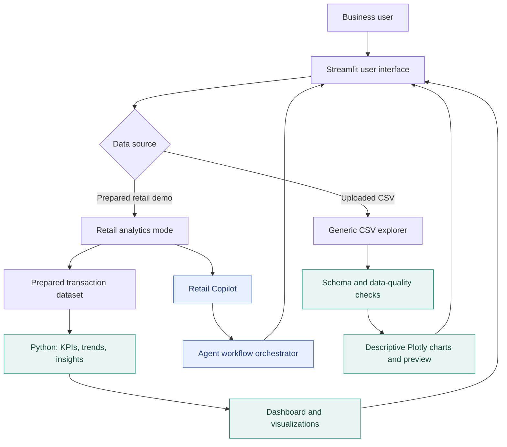
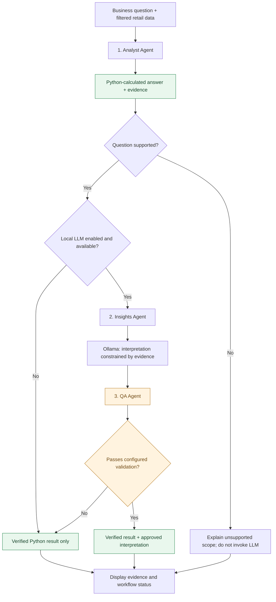

<div align="center">

# ◈ InsightPilot AI

### From raw transactions to evidence-backed business decisions

**An interactive decision intelligence studio with explainable retail analytics, a locally powered LLM Copilot, and a deterministic quality-assurance gate.**

Designed & developed by **Ruturaj** · AI Applications Capstone · **v1.2**

[](https://www.python.org/)
[](https://streamlit.io/)
[](https://pandas.pydata.org/)
[](https://plotly.com/python/)
[](https://ollama.com/)

[](#release-and-verification)
[](#testing-and-verification)
[](#multi-agent-copilot-how-it-works)
[](#license-and-data-rights)

[](https://insightpilot-ai-ruturaj.streamlit.app/)
[](https://github.com/RuturajM31/insightpilot_ai)

**[🚀 Launch the live app](https://insightpilot-ai-ruturaj.streamlit.app/)** · **[💻 View source on GitHub](https://github.com/RuturajM31/insightpilot_ai)** · **[Run locally](#quick-start--run-the-application)** · **[Architecture](#system-architecture)** · **[Testing](#testing-and-verification)**

**Public deployment:** Streamlit Community Cloud · **Cloud AI mode:** evidence-grounded Python answers (no hosted Ollama inference) · **Local AI mode:** optional Ollama / Llama 3.2

</div>

---

## Executive overview

Business teams rarely start with perfectly structured data or perfectly defined questions. InsightPilot AI is designed to make that first analytical step easier **without letting an LLM invent the numbers**.

The application offers two complementary experiences:

1. **Retail decision intelligence:** Explore a prepared transactional dataset with interactive KPIs, country and date filters, sales trends, data-quality checks, and a business-question Copilot.
2. **Bring-your-own-CSV exploration:** Upload a general CSV to inspect its schema, missing values, duplicates, distributions, categories, and data preview. This mode is descriptive; it does **not** promise general-purpose AI questions about arbitrary datasets.

The core design principle is **compute first, explain second, validate before displaying**. Python calculates the evidence; an optional local language model interprets it; a separate rule-based QA component can reject unsupported explanations.

### What makes the project distinctive?

| Design decision | Why it matters |
|---|---|
| Deterministic numerical calculations | The model is not responsible for generating sales totals or growth percentages. |
| Modular Analyst → Insights → QA pipeline | Calculation, narration, and checking have separate responsibilities. |
| Evidence-preserving fallback | Verified findings remain available when Ollama is offline or an interpretation fails QA. |
| Visible supporting evidence and execution trace | Users can inspect the analytical basis and the workflow outcome. |
| General CSV explorer | The app stays useful even outside its specialized retail analytics dataset. |
| Local-first LLM option | Ollama can run on the developer's computer without requiring a paid hosted API. |
| Automated regression testing | Changes to critical logic are checked, including a documented real-world hallucination regression. |

---

## What you can do

### Retail analytics dashboard

- **Executive KPIs:** Gross identified product sales, distinct sales invoices, average order value, and product cancellations.
- **Interactive slicing:** Filter by country and date range; dependent metrics and insights update on the selected records.
- **Trend analysis:** Explore monthly product sales, supported growth calculations, and period comparisons.
- **Transaction explorer:** Review underlying records and export a filtered CSV.
- **Data quality:** Inspect completeness, duplicates, and important classification caveats.
- **AI Copilot:** Ask supported retail business questions and review verified findings, optional AI interpretation, evidence, QA status, and the agent execution trace.

### Generic CSV workspace

- Upload a CSV file up to **25 MB** (application-level limit) and up to **1,000,000 rows**.
- Inspect record and column counts, missing cells, exact duplicate rows, column types, and a data preview.
- Explore distributions and category counts with interactive Plotly charts.
- Benefit from automatic, editable chart defaults that prioritize names such as `Revenue` and `Category` over date or identifier fields.
- Export a column-level dataset summary.

> **Scope note:** Retail-specific KPIs and Copilot capabilities apply to the **prepared Online Retail dataset**. Generic CSV uploads are explored descriptively; their arbitrary columns are not silently interpreted as retail revenue or orders.

---

## Application experience

**The retail demo includes four primary sections:**

| Section | Purpose | Typical decision support |
|---|---|---|
| Executive dashboard | Summary metrics and performance trends | Where and when did sales change? |
| Explore transactions | Inspect the records behind charts | Which transactions contribute to a metric? |
| Data quality | Check structure and data constraints | How much confidence should we place in the inputs? |
| AI Copilot | Verified question answering and optional interpretation | What can we say from the data, and what still needs investigation? |

**A generic CSV upload offers three sections:** Visual explorer, Data preview, and Data quality.

### Application screenshots

These captures are taken from the running application, including the deployed Streamlit version. The screenshots are illustrative: KPI values reflect the **USA filter** shown in the capture, not the full worldwide dataset.

**Executive dashboard — performance KPIs and country/date filters**


**Copilot — verified sales answer with transparent fallback**


**General CSV explorer — data quality and descriptive analytics**


> The images are static examples. Use the [live demo](https://insightpilot-ai-ruturaj.streamlit.app/) to interact with filters, charts, and supported business questions. The online demo uses verified Python analytics; local LLM-generated interpretations are available only with an accessible Ollama runtime.

---

## System architecture



### Main technology stack

| Layer | Technology | Role |
|---|---|---|
| Application UI | Streamlit | Uploads, filters, tabs, metrics, interaction, chat interface |
| Data processing | Python, Pandas, NumPy | Type handling, data preparation, aggregation and checks |
| Charts | Plotly | Interactive time-series, distributions and category charts |
| Retail calculations | Custom Python modules | Business definitions, KPIs, trends and insights |
| LLM runtime | Ollama | Optional **local** language-model inference |
| Primary local model | `llama3.2:3b` | Generates a bounded business interpretation from verified evidence |
| Workflow | Custom Python orchestration | Sequential Analyst → Insights → QA execution |
| Safeguards | Deterministic rules, tests | Format/evidence checks and rejection of identified unsupported claims |
| Tests | Pytest | Unit and regression checks |
| Public hosting target | Streamlit Community Cloud | Web-hosted verified analytics and rules-only Copilot fallback |

---

## Multi-agent Copilot: how it works

This is a **sequential multi-component agent workflow**. It does not claim autonomous tool discovery or a second AI model acting as the reviewer.



### Agent responsibilities

**1. Analyst Agent — authoritative calculations**  
Determines whether the question maps to one of the supported retail analytical operations and uses established Python logic to produce the answer and supporting evidence. This stage is deterministic; it is **not** an LLM guessing business numbers.

**2. Insights Agent — controlled interpretation**  
When enabled and available, passes the verified result to a locally hosted Ollama model and requests a short business interpretation. Generated content is supplementary to the verified calculation.

**3. QA Agent — rule-based acceptance gate**  
Checks structural validity, evidence consistency, explanation formatting, and configured patterns for unsupported causal, demand, trend, profitability and certainty claims. Explanations failing a check are withheld, while verified evidence remains visible.

**Important boundary:** Pattern-based QA reduces known risks but **does not prove that every approved sentence is semantically correct**. This is a guardrail, not a mathematical guarantee of LLM truthfulness.

### Example: evidence versus speculation

Suppose a filtered dataset shows its largest month-over-month product sales drop occurred in June 2011 at **−48.46%**. The Analyst can verify the percentage, but that number **does not prove** that buyers lost interest or that market demand fell.

- **Acceptable:** “Investigate whether product mix, order volume, inventory availability, or customer behavior changed.”
- **Unsupported:** “This decrease indicates a drop-off in customer interest or market demand.”

A local LLM test exposed the second type of claim; a QA rule and **four focused regression tests** were subsequently added. The goal is not to remove interpretation—it is to keep hypotheses separate from verified facts.

---

## From source data to trusted metrics


The sample project uses the **UCI Online Retail** dataset: approximately **541,909 raw transaction rows**, with dates covering December 2010 through December 2011. Local preprocessing classifies transaction types and stores derived fields such as `BusinessCategory`, `TransactionType`, `LineAmount`, and `ProductSalesAmount`.

### Key metric definitions

| Metric | Interpretation |
|---|---|
| **Gross product sales** | Positive transaction amounts classified as product sales, **before** cancellations and adjustments |
| **Sales invoices** | Distinct invoice IDs containing identified product sales |
| **Average order value (AOV)** | Gross product sales ÷ sales invoices |
| **Product cancellations** | Absolute value of classified product cancellation amounts; **not necessarily refunds** |
| **Monthly change** | Change between eligible comparable monthly product-sales totals, following the project’s trend logic |

**Accounting caveat:** These are analytical transaction metrics—not audited financial statements. The application does **not** claim they equal recognized revenue, realized profit, refunds, or contribution margin.

**Time coverage caveat:** The source ends on **9 December 2011**. A partial month should not be treated as comparable to a complete month without a deliberate adjustment. Completeness of a calendar period cannot be established from boundaries alone.

### Example verified result

For the full retail demo, the locally reviewed application reported approximately **£10.29 million** in classified gross product sales, **19,775** sales invoices and **£520.15** AOV. These figures describe the prepared dataset under the project's business definitions; actual values on screen depend on filters and the dataset version.

---

## Quick start — run the application

### Prerequisites

- **Python 3.11** recommended (used for the course project)
- Git (for cloning and version control)
- The project files, including `src/`, `app.py`, and `requirements.txt`
- A locally prepared retail demo file at either `data/online_retail_prepared.csv` **or** `data/online_retail_prepared.csv.gz`, if you want the retail dashboard
- **Optional:** Ollama and model `llama3.2:3b` for real local AI interpretations

> The generic CSV explorer can be used with your own CSV even if the retail demo file is not present, provided you upload the CSV first.

### Option A — Windows PowerShell

```powershell
# Open the project directory (adjust for your own computer)
cd "C:\Ruturaj\Projects\AI Applications\Dozenten_Uploads-20261006\InsightPilot_AI"

# Activate your existing Conda environment
conda activate insightpilot_env

# Install project packages
python -m pip install -r requirements.txt

# Run automated tests
python -m pytest -q

# Launch the application
python -m streamlit run app.py
```

Then open **http://localhost:8501** in your browser.

### Option B — Clean Python virtual environment

```bash
python -m venv .venv
# Windows PowerShell: .venv\Scripts\Activate.ps1
# macOS/Linux: source .venv/bin/activate
python -m pip install -r requirements.txt
python -m pytest -q
python -m streamlit run app.py
```

### Enable local LLM interpretations (optional)

With Ollama installed and running on the same computer:

```powershell
ollama pull llama3.2:3b
$env:INSIGHTPILOT_OLLAMA_MODEL = "llama3.2:3b"
python -m streamlit run app.py
```

Enable **local AI explanations** in the retail Copilot interface. If Ollama is unavailable or the explanation is rejected, the app can still display the verified Python answer.

**No Ollama?** The application remains useful as a Python-powered analytics dashboard and evidence-based retail question-answering interface.

---

## Project structure

```text
InsightPilot_AI/
├── app.py                         # Streamlit UI and page orchestration
├── README.md                      # Portfolio and developer documentation
├── requirements.txt               # Python package requirements
├── .gitignore                     # Local, transient and sensitive-file exclusions
├── data/
│   └── online_retail_prepared.csv.gz # Compressed retail demo data (committed)
├── src/
│   ├── data_cleaning.py           # Transaction cleaning / business classification
│   ├── csv_analyzer.py            # CSV analytical utilities
│   ├── retail_kpis.py             # Verified retail metrics
│   ├── sales_trends.py            # Time-series / growth calculations
│   ├── business_insights.py       # Evidence-based business observations
│   ├── ai_copilot.py              # Question routing / retail Q&A
│   ├── llm_engine.py              # Ollama adapter and validation
│   └── agents/
│       ├── analyst_agent.py
│       ├── insights_agent.py
│       ├── qa_agent.py
│       └── agent_workflow.py
├── assets/                         # Application screenshots
│   ├── dashboard.png
│   ├── ai-copilot.png
│   └── csv-explorer.png
└── tests/                          # Pytest suite and QA regression tests
```

The tree highlights the released source files and accompanying screenshot assets. Original uncompressed CSVs, local source workbooks, caches, and temporary backups are excluded from Git. The screenshot assets are included with this documentation update.

---

## How the project was developed

This project evolved through a sequence of engineering and verification stages rather than starting from an untested AI chatbot:


**1. Frame the analytical questions.** The initial objective was to answer practical business-performance questions while clearly defining how each metric was calculated.

**2. Build the data foundation.** Data types and transaction classifications were introduced so sales and cancellations could be interpreted consistently.

**3. Separate arithmetic from language generation.** Retail KPIs and trends are calculated in Python. This avoids using free-form LLM text as the source of truth for financial figures.

**4. Create the interface.** Streamlit and Plotly provide a filterable dashboard, interactive charts and a Copilot view.

**5. Introduce optional local AI.** Ollama adds natural-language interpretation without replacing the verified numerical result.

**6. Introduce the QA gate.** The three-stage sequence checks that an AI interpretation is suitable to display, and preserves a safe, verified fallback.

**7. Test realistic failure cases.** Automated tests and hands-on validation exposed issues involving inferred business causes, user input and unsupported queries. A documented Germany scenario led to further QA regression coverage.

**8. Expand beyond a single dataset.** General CSV exploration was added with data-quality metrics, chart defaults and graceful handling of empty uploads.

**9. Prepare for publication.** Git initialization, ignore rules, requirements review and deployment planning support a reproducible portfolio release. **The application has since been published to GitHub and deployed to Streamlit Community Cloud.**

---

## Testing and verification

The latest user-run local test suite reported:

```text
............................................................................ [100%]
76 passed in 0.66s
```

The v1.2 app also passed a local Python compilation check:

```powershell
python -m py_compile app.py
python -m pytest -q
```

### Verification matrix

| Scenario | Observed outcome |
|---|---|
| Automated Python regression suite | **76 passed** on the user's local environment |
| Retail-specific country/date filtering | Exercised during local testing |
| Analyst → Insights → QA interaction | Local Ollama explanation flow exercised |
| Unsupported customer-interest inference | Rejected after targeted QA regression fix |
| Generic six-row CSV upload | **6 rows, 5 columns, 0 missing cells, 0 exact duplicates** |
| Generic chart defaults | `Revenue` and `Category` selected after v1.2 UI update |
| Header-only CSV | Friendly validation error rather than a Python traceback |
| Public Streamlit deployment | **Verified from live-application screenshots:** dataset, filters, KPI cards, supported Copilot question and QA/rules fallback |
| Cloud LLM inference | **Not available**: local Ollama is not accessible from the hosted app |

**Reproducibility note:** The reported tests cover the local project state at the time they were run. Passing tests do not substitute for a deployment smoke test, and safeguards are limited to the behaviors they actually validate.

### Test with a small CSV

```csv
Date,Product,Category,Units,Revenue
2026-01-05,Laptop,Electronics,3,2400
2026-01-12,Mouse,Accessories,15,375
2026-02-03,Keyboard,Accessories,8,640
2026-02-15,Monitor,Electronics,4,1200
2026-03-07,Laptop,Electronics,2,1600
2026-03-21,Mouse,Accessories,20,500
```

Expected health indicators: **6 records · 5 columns · 0 missing cells · 0 exact duplicates**.

---

## Deployment guide

### Publish to GitHub

1. Review `git status --short` and `.gitignore`; exclude temporary test data, backups, local environment files, secrets and any data not permitted for publication.
2. Confirm `requirements.txt` includes the packages needed to run `app.py`.
3. Prepare the demo data as described below **only if redistribution is permitted**.
4. Commit the final source, tests, README and permitted static assets.
5. Create a GitHub repository and push the chosen branch.
6. Add the repository URL to the **Live demo / repository** area at the top of this document.

### Prepare the full demo dataset for Streamlit Cloud

For an existing `data/online_retail_prepared.csv`, Pandas can create a compressed copy:

```powershell
python -c "import pandas as pd; d=pd.read_csv('data/online_retail_prepared.csv',low_memory=False); d.to_csv('data/online_retail_prepared.csv.gz',index=False,compression='gzip')"
```

The project already publishes `data/online_retail_prepared.csv.gz`, verified at **541,909 rows, 12 columns, approximately 9.24 MB**. The app prefers `.csv.gz` and falls back to the uncompressed local CSV. Compression does not sample or intentionally remove records.

### Current live deployment

**[Open InsightPilot AI](https://insightpilot-ai-ruturaj.streamlit.app/)** · **[View the GitHub repository](https://github.com/RuturajM31/insightpilot_ai)**

The deployed dashboard has been checked with the compressed retail dataset and a supported USA-filtered Copilot question. The hosted interpretation status is **`Engine: verified_rules · QA: fallback`**, which means Python verified the answer but did not generate a hosted LLM explanation. The local Ollama toggle is currently visible in the deployed interface; users should leave it off in the cloud environment.

### Deploy with Streamlit Community Cloud

1. Open [Streamlit Community Cloud](https://share.streamlit.io/).
2. Choose your GitHub repository, branch and entry point **`app.py`**.
3. Allow Streamlit to install `requirements.txt`.
4. Configure `INSIGHTPILOT_DEPLOYMENT=cloud` in the deployment environment where supported.
5. Test startup, demo loading, filters, Copilot fallback and a generic CSV upload using the **actual public URL**.
6. Add that verified URL to the opening section of this README.

> **Critical deployment distinction:** Streamlit Community Cloud cannot reach an Ollama service running on your Windows computer at `localhost`. The cloud version can provide the verified Python analytics / Copilot fallback, but **real LLM-powered interpretations require local Ollama or an explicitly implemented and tested remote model endpoint**. Do not advertise cloud LLM inference unless it is genuinely configured and verified.

### Deployment checklist

- [ ] Data redistribution rights reviewed and appropriate source attribution included
- [x] Compressed demo file included on GitHub (redistribution rights must still be independently reviewed)
- [x] Git preview excluded local datasets, source workbooks and source-code backups
- [x] Local automated regression suite passed (76 tests)
- [ ] Anonymous/incognito access independently confirmed
- [x] Cloud answer identifies `verified_rules` and `fallback` (UI wording can be improved)
- [x] Screenshots supplied with this documentation release
- [x] GitHub and live-demo links included in this README

---

## Trade-offs, limitations and responsible use

- **Defined question scope:** The retail Copilot handles supported business questions, not unrestricted conversational data science.
- **Rule-based QA:** QA detects configured issues, but it cannot certify every semantic assertion or independently prove causality.
- **No automated causal inference:** A sales change does not establish marketing effectiveness, product-market fit, inventory shortages, or shifts in demand.
- **No audited revenue or profit claims:** Gross classified product sales and cancellation amounts are analytical constructs.
- **Incomplete-period comparability:** Partial calendar months need explicit attention.
- **CSV input boundaries:** Upload limits, heuristic field selection and data type inference impose practical constraints; uploaded data are not automatically cleaned or enriched.
- **Local-model constraints:** Ollama inference performance and availability depend on the computer and model installation. Public cloud deployment is a different execution environment.
- **Data stewardship:** Avoid publishing customer-level personal data; check the dataset’s terms and redistribution rights before committing prepared records.

---

## Future enhancements

Potential improvements, **not claimed as existing features**:

- Cloud-hosted LLM adapter with explicit authentication, cost controls and health checks.
- Configurable data mapping for arbitrary business CSV schemas.
- Extended semantic QA, citation-based interpretation and richer uncertainty language.
- User-managed metric definitions and additional retail dimensions.
- Formal CI tests and automated Streamlit deployment smoke tests.
- Hosted walkthrough video, architecture screenshots and a compact case-study page.

---

## Presentation guide — suggested 5–7 minute walkthrough

| Time | What to demonstrate | Message to emphasize |
|---|---|---|
| 0:00–0:45 | Problem and executive dashboard | Business data should be understandable and traceable. |
| 0:45–1:45 | Country/date filters and KPIs | Numbers come from Python business rules. |
| 1:45–3:15 | Copilot question, evidence and agent trace | Three stages: verify → interpret → check. |
| 3:15–4:15 | Rejected explanation / fallback | Preventing unsupported confidence matters more than polished hallucinations. |
| 4:15–5:15 | Generic CSV explorer and quality checks | Useful functionality beyond one preloaded dataset. |
| 5:15–6:15 | Architecture, tests and limitations | 76 local passing tests, transparent scope and next steps. |
| 6:15–7:00 | GitHub README and deployment plans | Reproducibility and portfolio-ready presentation. |

**Suggested closing statement:** *“InsightPilot AI demonstrates how analytical accuracy, natural-language assistance, and quality controls can work together. Instead of treating an LLM as the source of numerical truth, the system computes the evidence first and only then allows a checked interpretation.”*

---

## Dataset attribution

**UCI Machine Learning Repository — [Online Retail](https://archive.ics.uci.edu/dataset/352/online+retail)**. See the repository’s current dataset description and licensing terms before redistributing data. The accompanying research is commonly cited as:

Chen, D., Sain, S. L., & Guo, K. (2012). *Data mining for the online retail industry: A case study of RFM model-based customer segmentation using data mining.*

## License and data rights

**No source-code license has been selected yet.** Do not assume an MIT or open-source license until a `LICENSE` file has been deliberately added. Dataset usage and redistribution rights are separate from source-code licensing.

---

<div align="center">

### ◈ InsightPilot AI — Data. Evidence. Decisions.

**Designed & developed by Ruturaj**  
Python · Pandas · Plotly · Streamlit · Ollama · Modular AI Workflow

*Portfolio project · AI Applications · October 2026*

</div>
